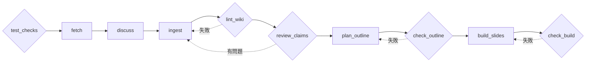

# 量子計算 LLM Wiki

用 LLM Wiki 的方式把 6 篇英文維基百科條目整理成量子計算入門知識庫，再只用這份知識庫做出教學 HTML 簡報「量子電腦是什麼？」。

- 網站：https://arthur031221.github.io/quantum-llm-wiki/
- 教學簡報：https://arthur031221.github.io/quantum-llm-wiki/slides.html
- Wiki：https://arthur031221.github.io/quantum-llm-wiki/wiki.html
- 流程與反思：https://arthur031221.github.io/quantum-llm-wiki/workflow.html（原文在 [WORKFLOW.md](WORKFLOW.md)）
- AI 專案規則：[CLAUDE.md](CLAUDE.md)

## 資料怎麼流

```
sources.json → raw/（原文，唯讀）→ discussions/（先討論）→ wiki/（知識庫）→ slides/outline.md → slides.html
```

每一層只讀上一層。投影片右下角標了用到的 wiki 頁面，wiki 頁面列出原始條目和討論紀錄，也列出哪幾張投影片用到它。

## 流程（graph v3）



## 怎麼跑

```bash
python3 scripts/run_pipeline.py v3 --note "這次改了什麼"   # 跑完整流程，紀錄寫進 runs/
python3 scripts/lint_wiki.py --evidence                  # 列出 wiki 每個數字在原文的出處
python3 scripts/check_slides.py all                      # 檢查大綱與建置結果
python3 scripts/build_slides.py                          # 重新產生 slides.html
python3 -m http.server 8000                              # 本機預覽
```

只用 Python 標準函式庫，不需要安裝套件。

## 資料夾

| 路徑 | 內容 |
|---|---|
| `raw/` | 6 篇維基百科條目的純文字，附版本號與授權 |
| `discussions/` | 每篇來源的討論紀錄 |
| `wiki/` | 8 個概念頁、`index.md`、`log.md` |
| `slides/` | 簡報大綱與 wiki 對投影片的對照表 |
| `runs/` | 9 次執行紀錄與說法審查紀錄 |
| `scripts/` | 流程中的腳本節點 |

## 授權

`raw/` 與 wiki 內容改寫自英文維基百科，依 CC BY-SA 4.0 授權。
