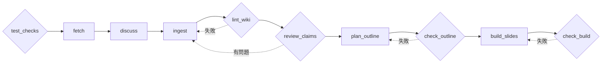

# 量子計算LLM Wiki

我照LLM Wiki的做法，把6篇英文維基百科條目整理成量子計算入門的知識庫，再只用這份知識庫做出教學HTML簡報「量子電腦是什麼？」。

- 網站 https://arthur031221.github.io/quantum-llm-wiki/
- 教學簡報 https://arthur031221.github.io/quantum-llm-wiki/slides.html
- Wiki https://arthur031221.github.io/quantum-llm-wiki/wiki.html
- 流程與反思 https://arthur031221.github.io/quantum-llm-wiki/workflow.html ，原文在[WORKFLOW.md](WORKFLOW.md)
- 給AI看的專案規則在[CLAUDE.md](CLAUDE.md)

## 資料怎麼流

`sources.json`列出要抓的條目，抓下來的原文放在唯讀的`raw/`，每篇先在`discussions/`寫討論紀錄，再整理進`wiki/`，簡報大綱`slides/outline.md`只能用wiki的內容，最後由腳本建置成`slides.html`。

每一層只讀上一層，投影片右下角標了出自哪幾頁wiki，wiki頁面則列出原始條目、討論紀錄，以及哪幾張投影片用到它。

## 流程graph v3



## 怎麼跑

整個流程用一行指令跑完，每次的紀錄會寫進`runs/`，只用Python標準函式庫，不必安裝套件。

```bash
python3 scripts/run_pipeline.py v3 --note "這次改了什麼"
```

## 授權

`raw/`和wiki的內容改寫自英文維基百科，依CC BY-SA 4.0授權。
