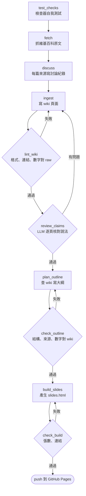
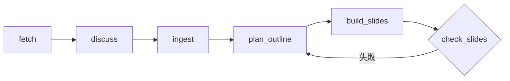

# Loop / Graph 設計、執行紀錄與反思

這份文件說明資料怎麼從維基百科一路變成教學簡報、每一步怎麼檢查，以及實際跑了 9 次之後學到什麼。流程前後改了兩版，最後是 graph v3。

## 1. 最終流程（graph v3）

| 節點 | 類型 | 讀什麼 | 產出什麼 | 失敗時回到 |
|---|---|---|---|---|
| test_checks | 腳本 | 固定的測試案例 | 檢查器是否正常 | 修檢查器 |
| fetch | 腳本 | `sources.json` | `raw/*.md`（唯讀）、`raw/manifest.json` | fetch |
| discuss | LLM | 一篇 raw | `discussions/<同名>.md` | discuss |
| ingest | LLM | 討論紀錄、raw | `wiki/*.md`、`index.md`、`log.md` | ingest |
| lint_wiki | 腳本 | wiki、raw、討論紀錄 | 問題清單、數字出處（evidence） | ingest |
| review_claims | LLM | wiki、raw | `runs/review-claims.md` | ingest |
| plan_outline | LLM | 只讀 wiki（先讀 index 再讀頁面） | `slides/outline.md` | plan_outline |
| check_outline | 腳本 | 大綱、wiki | 問題清單 | plan_outline |
| build_slides | 腳本 | 大綱 | `slides.html`、`slides/slide-map.json` | build_slides |
| check_build | 腳本 | `slides.html` | 問題清單 | build_slides |

腳本節點由 `scripts/run_pipeline.py` 執行。LLM 節點由 Claude Code 依照 `CLAUDE.md` 的規則完成，pipeline 只檢查它們的產物：討論紀錄是否齊全、審查紀錄是否比 wiki 新等等。所以 run 紀錄裡 LLM 節點的耗時都是 0 秒。

### 「先討論、後生成」怎麼落實

每篇來源先寫一份討論紀錄，固定四段：這篇在講什麼、初學者需要的重點（標出原文章節）、要寫進哪些 wiki 頁、疑點與決定。討論完才寫 wiki。

`lint_wiki.py` 會擋下「引用了還沒討論過的來源」的 wiki 頁面。討論紀錄也改變了後面的內容。例如在討論 01 篇時就發現純文字抽取把 $2^{100}$ 變成「2100」、$1/\sqrt2$ 變成「12」，寫 wiki 時才知道要還原；討論 01 篇時也決定量子霸權一定要同時寫 Google 的主張和 IBM 的反駁。

## 2. 哪些步驟會重複執行

1. 每篇來源跑一次 discuss。之後要新增來源，只要在 `sources.json` 加一行，fetch 會跳過已經抓過的檔案，只抓新的，再對新來源跑 discuss、ingest。
2. ingest → lint_wiki → review_claims 是一個迴圈。任何一個檢查不過就回到 ingest 改 wiki，改完要整段重跑。review_claims 的紀錄必須比所有 wiki 頁面新，所以 wiki 只要改過，審查就得重做，不會拿舊的審查結果過關。
3. plan_outline → check_outline 是第二個迴圈，投影片內容有問題只回到大綱，不用動 wiki。
4. build_slides → check_build 是第三個迴圈，只處理建置問題。
5. 同一個節點連續失敗 3 次就停下來，把狀況寫進 `wiki/log.md` 交給人判斷，避免 LLM 一直重寫同一段。

## 3. 哪些地方需要檢查或重新生成

| 檢查 | 位置 | 擋什麼 |
|---|---|---|
| 檢查器自我測試 | 最前面 | 數字比對的誤判（巧合撞到、標頭日期、ket 標籤） |
| 討論閘門 | lint_wiki | 沒討論過的來源被寫進 wiki |
| 數字落地 | lint_wiki | wiki 的數字在原文找不到 |
| 說法核對 | review_claims | wiki 裡沒有數字、但超出來源的說法 |
| 教學結構 | check_outline | 缺學習目標、小測驗、重點整理、參考資料；單張超過 6 點 |
| 來源標註 | check_outline | 投影片沒標 wiki 來源，或標了不存在的頁面 |
| 數字落地 | check_outline | 投影片的數字在引用的 wiki 頁找不到 |
| 建置一致 | check_build | 投影片張數和大綱不同、來源連結壞掉 |

數字比對的規則：大於 10 的數字（年份、量子位元數、位元長度等）都要在來源找到。小於等於 10 的數字太常見，比對沒有意義，所以跳過。「300 萬」這類中文單位會換算成 3 million 再找。

## 4. 為什麼這樣設計

- 每一層只讀上一層。簡報只能用 wiki，wiki 只能用 raw。這樣任何一句話都能一路追回原文，投影片右下角也標了 wiki 來源，點了就能看到那一頁，wiki 頁面再列出原始條目。
- 能用程式檢查的就用程式。格式、連結、數字出處這些規則明確的東西交給腳本，每次都一樣，不會累。
- 程式檢查不了的交給 LLM，但要留下紀錄。說法有沒有超出來源需要讀懂語意，只能人或 LLM 判斷，所以 review_claims 一定要產出紀錄檔，pipeline 才能確認它做過，而且審的是最新版的 wiki。
- 檢查放在錯誤發生的地方。wiki 的錯在 wiki 階段抓，投影片的錯在大綱階段抓，建置問題在建置後抓。失敗時要回到哪個節點也因此很清楚。
- 檢查器也要被檢查。這是跑完之後才學到的，見第 6 節。

## 5. 實際執行紀錄

| Run | Graph | 結果 | 發生什麼事 |
|---|---|---|---|
| [01](runs/run-01-v1.md) | v1 | 失敗：check_slides | 封面寫了「20 分鐘」，wiki 沒有這個數字。LLM 在 plan_outline 自己加了內容 |
| [02](runs/run-02-v1.md) | v1 | 通過 | 改掉封面後通過。但 v1 從來沒檢查 wiki 本身 |
| [03](runs/run-03-v2.md) | v2 | 失敗：test_checks | 新加的自我測試有一個案例寫錯（預期擋下的日期，原文本文就有） |
| [04](runs/run-04-v2.md) | v2 | 通過 | |
| [05](runs/run-05-v3.md) | v3 | 失敗：review_claims | 還沒有說法審查紀錄。接著做審查，找到 5 處超出來源的說法 |
| [06](runs/run-06-v3.md) | v3 | 通過 | 修正 5 處說法後通過 |
| [07](runs/run-07-v3.md) | v3 | 通過 | 審查紀錄刪掉沒有實際計數的欄位後重跑 |
| [08](runs/run-08-v3.md) | v3 | 失敗：review_claims | 修飾文字時改了 4 句 wiki，審查紀錄比 wiki 舊，被擋下 |
| [09](runs/run-09-v3.md) | v3 | 通過 | 重審改寫的 4 句後通過，這是最後發布的版本 |

完整的節點輸出（包含每個數字在原文的出處）在每份 run 紀錄裡。說法審查的結果在 [runs/review-claims.md](runs/review-claims.md)，每次修正的時間順序在 [wiki/log.md](wiki/log.md)。

run 09 的節點結果：

| # | 節點 | 類型 | 結果 |
|---|---|---|---|
| 1 | test_checks | 腳本 | 通過（7/7 個案例） |
| 2 | fetch | 腳本 | 通過（6 篇都已抓過，跳過） |
| 3 | discuss | LLM | 通過（6 篇來源都有討論紀錄） |
| 4 | ingest | LLM | 通過（8 個 wiki 頁面） |
| 5 | lint_wiki | 腳本 | 通過，並列出 wiki 裡每個數字在原文的出處 |
| 6 | review_claims | LLM | 通過（審查紀錄比 wiki 新） |
| 7 | plan_outline | LLM | 通過 |
| 8 | check_outline | 腳本 | 通過（17 張投影片） |
| 9 | build_slides | 腳本 | 通過 |
| 10 | check_build | 腳本 | 通過 |

## 6. Graph 怎麼一路改過來

### v1：檢查全部放在最後

一開始的想法很直接：最後檢查簡報就好。run 01 也確實在最後抓到了「20 分鐘」。

問題是 check_slides 只拿投影片去比對 wiki。如果 wiki 本身寫錯，投影片照著 wiki 抄，檢查一樣會通過。v1 沒有任何一步檢查 wiki。

### v2：數字檢查往前移到 ingest 後面

- lint_wiki 放在 ingest 後面，wiki 的數字直接比對 raw。
- 投影片檢查拆成兩段：建置前的 check_outline、建置後的 check_build。
- lint_wiki 一律輸出 evidence，列出每個數字在原文的出處。

第一次跑 lint_wiki 時它說「通過」，可是逐條看 evidence 才發現，有些數字是巧合才通過的：

- wiki 的「300 萬」對到原文的「two **300**-digit primes」，正確的出處是「**3 million** physical qubits」。
- raw 檔標頭的抓取日期、版本時間戳也被拿來比對，「20」「11」「2026」先對到了標頭。
- |11⟩ 這種 ket 標籤被當成數字。
- 把「300 萬」換算成 3,000,000 之後，又先撞到 Sycamore 那段的「3,000,000 times faster」。

所以 v2 也把檢查器修好，並加上 test_checks，在跑任何東西之前先確認檢查器沒有壞。run 03 就停在這裡：我自己寫的測試案例有一個是錯的。

### v3：補上數字以外的說法

數字檢查只管數字。像「很多古典邏輯閘（例如 AND）不可逆」這種句子沒有數字，lint_wiki 一定放行。v3 在 lint_wiki 後面加上 review_claims，由 LLM 逐頁回到 raw 核對說法，找到 5 個問題。

## 7. 反思

### 哪一個節點最常出錯？

ingest。它一共出了 5 個問題，都是 review_claims 抓到的：

- 順手補上自己知道、大致正確但來源沒寫的說法（例如 AND 不可逆、測量問題仍有爭論）。
- 把原文的程度詞換成更強的詞（most scalable 寫成「最好的」）。
- 說法本身有出處，但出處是別篇來源，這一頁的 sources 沒列那篇。

這些錯誤的共同點是：句子讀起來都對，也都沒有數字，所以格式檢查和數字檢查都看不出來。plan_outline 也出過一次錯（封面的「20 分鐘」），性質一樣，都是 LLM 加了來源以外的東西。

另一個意外是檢查節點本身。lint_wiki 第一次跑就說通過，但其中有幾個數字是巧合對上的。如果只看「通過」兩個字，就會以為 wiki 沒問題。

### 發現問題後，把檢查往前移到了哪一步？

1. 數字落地檢查從最後的 check_slides 往前移到 ingest 之後（lint_wiki），wiki 的錯在進入投影片之前就被擋下。
2. 說法核對（review_claims）也放在 ingest 之後、plan_outline 之前，不讓超出來源的說法流進簡報。
3. 投影片內容檢查移到建置之前（check_outline），只有建置相關的檢查留在最後。
4. 最前面加上 test_checks，在信任檢查結果之前先確認檢查器本身沒壞。

### 有沒有因此修改 workflow / graph？為什麼？

有，從 v1 改到 v3：

- v1 → v2：v1 的檢查只看最後一層，前面的錯會被一路複製下去，到最後反而看起來「有根據」。把檢查放到錯誤發生的那一層，失敗時也知道該回到哪裡改。
- v2 → v3：數字檢查擋不住沒有數字的錯，而 ingest 最常犯的正是這種錯，所以加上 review_claims，並要求審查紀錄必須比 wiki 新，避免拿舊的審查過關。
- 檢查器加上自我測試和 evidence 輸出，是因為這次學到「檢查通過」不等於「內容正確」，檢查器自己也可能錯。

### 還沒解決的地方

- review_claims 是 LLM 自己審自己寫的東西，可能有盲點。比較好的做法是換一個模型或請人來審。
- 數字比對只確認「原文某處有這個數字」，不確認上下文是同一件事。evidence 輸出讓人可以檢查，但還是要有人看。
