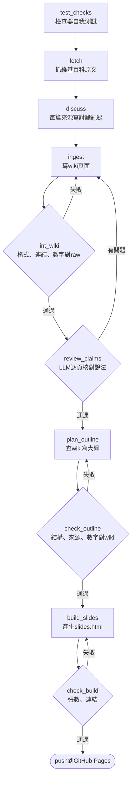
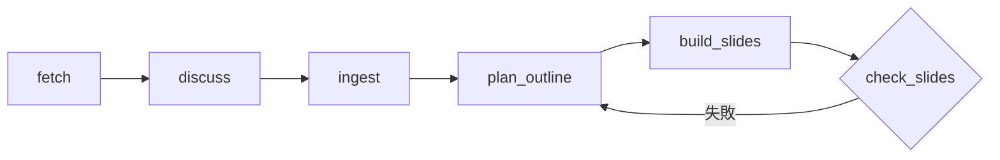

# Loop和Graph的設計、執行紀錄與反思

資料從維基百科一路變成教學簡報，中間每一步怎麼檢查，實際跑了11次之後學到什麼，都寫在這裡，流程前後改了兩次，最後定在graph v3。

## 1. 最終流程graph v3

| 節點 | 類型 | 讀什麼 | 產出什麼 | 失敗時回到 |
|---|---|---|---|---|
| test_checks | 腳本 | 固定的測試案例 | 檢查器正不正常 | 修檢查器 |
| fetch | 腳本 | `sources.json` | 唯讀的`raw/*.md`和`raw/manifest.json` | fetch |
| discuss | LLM | 一篇raw | `discussions/<同名>.md` | discuss |
| ingest | LLM | 討論紀錄和raw | `wiki/*.md`、`index.md`、`log.md` | ingest |
| lint_wiki | 腳本 | wiki、raw和討論紀錄 | 問題清單，加上每個數字的出處 | ingest |
| review_claims | LLM | wiki和raw | `runs/review-claims.md` | ingest |
| plan_outline | LLM | 只讀wiki，先讀index再讀頁面 | `slides/outline.md` | plan_outline |
| check_outline | 腳本 | 大綱和wiki | 問題清單 | plan_outline |
| build_slides | 腳本 | 大綱 | `slides.html`和`slides/slide-map.json` | build_slides |
| check_build | 腳本 | `slides.html` | 問題清單 | build_slides |

腳本節點由`scripts/run_pipeline.py`執行，LLM節點由Claude Code照`CLAUDE.md`的規則完成，pipeline只檢查它們的產物，例如討論紀錄齊不齊全、審查紀錄是不是比wiki新，所以run紀錄裡LLM節點的耗時都是0秒。

### 先討論再生成怎麼落實

每篇來源先寫一份討論紀錄，固定四段，分別寫這篇在講什麼、初學者需要的重點和原文章節、要寫進哪些wiki頁，還有疑點與決定，討論完才寫wiki。

`lint_wiki.py`會擋下引用了還沒討論過的來源的wiki頁面，討論紀錄也確實改變了後面的內容。

討論01篇時就發現純文字抽取把$2^{100}$變成「2100」，把$1/\sqrt2$變成「12」，寫wiki時才知道要還原，也是在討論01篇時決定，量子霸權一定要同時寫Google的主張和IBM的反駁。

## 2. 哪些步驟會重複執行

1. 每篇來源跑一次discuss，之後想加新來源，在`sources.json`加一行就好，fetch會跳過已經抓過的檔案只抓新的，再對新來源跑discuss和ingest
2. ingest、lint_wiki和review_claims是第一個迴圈，任何一個檢查不過就回到ingest改wiki，改完整段重跑，review_claims的紀錄必須比所有wiki頁面新，wiki只要改過審查就得重做，沒辦法拿舊的審查結果過關
3. plan_outline和check_outline是第二個迴圈，投影片內容出問題只回到大綱，不用動wiki
4. build_slides和check_build是第三個迴圈，只處理建置的問題
5. 同一個節點連續失敗三次就停下來，把狀況寫進`wiki/log.md`交給人判斷，免得LLM一直重寫同一段

## 3. 哪些地方需要檢查或重新生成

| 檢查 | 位置 | 擋什麼 |
|---|---|---|
| 檢查器自我測試 | 最前面 | 數字比對的誤判，像巧合撞到、標頭日期和ket標籤 |
| 討論閘門 | lint_wiki | 沒討論過的來源被寫進wiki |
| 數字落地 | lint_wiki | wiki的數字在原文找不到 |
| 說法核對 | review_claims | wiki裡沒有數字、卻超出來源的說法 |
| 教學結構 | check_outline | 少了學習目標、小測驗、重點整理或參考資料，單張超過六點 |
| 來源標註 | check_outline | 投影片沒標wiki來源，或標了不存在的頁面 |
| 數字落地 | check_outline | 投影片的數字在引用的wiki頁找不到 |
| 建置一致 | check_build | 投影片張數和大綱不同，或來源連結壞掉 |

數字比對只管大於10的數字，像年份、量子位元數和位元長度，這些都得在來源裡找到，小於等於10的數字太常見，比對沒有意義就跳過，「300萬」這種中文單位會先換算成3 million再找。

## 4. 為什麼這樣設計

每一層只讀上一層，簡報只能用wiki，wiki只能用raw，任何一句話都能一路追回原文，投影片右下角標了出自哪幾頁wiki，點下去就是那一頁，wiki頁面再列出原始條目。

格式、連結和數字出處這種規則明確的東西交給腳本，每次結果都一樣，也不會累，說法有沒有超出來源得讀懂語意，只能交給人或LLM，可是一定要留下紀錄，pipeline才能確認審查真的做過，而且審的是最新版的wiki。

檢查放在錯誤發生的那一層，wiki的錯在wiki階段抓，投影片的錯在大綱階段抓，建置的問題在建置後抓，失敗時該回到哪個節點也就很清楚，最後一點是跑完才學到的，檢查器本身也要被檢查，第6節會講。

## 5. 實際執行紀錄

| Run | Graph | 結果 | 發生什麼事 |
|---|---|---|---|
| [01](runs/run-01-v1.md) | v1 | 停在check_slides | 封面寫了「20分鐘」，wiki沒有這個數字，是LLM在plan_outline自己加的 |
| [02](runs/run-02-v1.md) | v1 | 通過 | 改掉封面就過了，但v1從來沒檢查wiki本身 |
| [03](runs/run-03-v2.md) | v2 | 停在test_checks | 新加的自我測試有一個案例寫錯，預期要擋的日期原文本文就有 |
| [04](runs/run-04-v2.md) | v2 | 通過 | |
| [05](runs/run-05-v3.md) | v3 | 停在review_claims | 還沒有說法審查紀錄，接著做審查，找到5處超出來源的說法 |
| [06](runs/run-06-v3.md) | v3 | 通過 | 修正那5處說法後通過 |
| [07](runs/run-07-v3.md) | v3 | 通過 | 審查紀錄刪掉沒有實際算過的欄位後重跑 |
| [08](runs/run-08-v3.md) | v3 | 停在review_claims | 修飾文字時改了4句wiki，審查紀錄比wiki舊，被擋下來 |
| [09](runs/run-09-v3.md) | v3 | 通過 | 重審那4句後通過 |
| [10](runs/run-10-v3.md) | v3 | 通過 | 照新的寫作規則改寫全部文字，修好數字緊貼中文時被跳過的問題，逐頁重審後通過 |
| [11](runs/run-11-v3.md) | v3 | 通過 | 段落中間的句號改成逗號或改成分段，只動標點，重審後通過，這是最後發布的版本 |

每份run紀錄裡都有完整的節點輸出，包括每個數字在原文的出處，說法審查的結果在[runs/review-claims.md](runs/review-claims.md)，每次修正的先後順序在[wiki/log.md](wiki/log.md)。

最後一次run 11的節點結果如下，test_checks的8個案例全部通過，fetch發現6篇都抓過了就跳過，討論紀錄齊全，8個wiki頁面的數字都找得到出處，審查紀錄比wiki新，17張投影片通過大綱和建置檢查。

| # | 節點 | 類型 | 結果 |
|---|---|---|---|
| 1 | test_checks | 腳本 | 通過 |
| 2 | fetch | 腳本 | 通過 |
| 3 | discuss | LLM | 通過 |
| 4 | ingest | LLM | 通過 |
| 5 | lint_wiki | 腳本 | 通過 |
| 6 | review_claims | LLM | 通過 |
| 7 | plan_outline | LLM | 通過 |
| 8 | check_outline | 腳本 | 通過 |
| 9 | build_slides | 腳本 | 通過 |
| 10 | check_build | 腳本 | 通過 |

## 6. Graph怎麼一路改過來

### v1把檢查全部放在最後

一開始的想法很單純，最後檢查簡報就好，run 01也確實在最後抓到了「20分鐘」。

麻煩在於check_slides只拿投影片去比對wiki，wiki本身要是寫錯，投影片照著wiki抄，檢查一樣會過，v1沒有任何一步在檢查wiki。

### v2把數字檢查往前移到ingest後面

lint_wiki放到ingest後面，直接拿wiki的數字去比對raw，而且一律輸出evidence，列出每個數字在原文的出處，投影片檢查也拆成建置前的check_outline和建置後的check_build。

第一次跑lint_wiki時它說通過，逐條看evidence才發現有些數字是巧合才過的。

wiki的「300萬」對到的是原文「two 300-digit primes」裡的300，正確的出處是「3 million physical qubits」，raw檔標頭的抓取日期和版本時間戳也被拿來比對，「20」「11」「2026」都先撞到了標頭，|11⟩這種ket標籤也被當成數字。

把「300萬」換算成3,000,000之後，又先撞上Sycamore那段的「3,000,000 times faster」。

所以v2順便把檢查器修好，再加上test_checks，跑任何東西之前先確認檢查器沒壞，run 03就停在這一步，因為我自己寫的測試案例有一個是錯的。

### v3補上數字以外的說法

數字檢查只管數字，「很多古典邏輯閘，例如AND，不可逆」這種句子沒有數字，lint_wiki一定放行，v3在lint_wiki後面加上review_claims，讓LLM逐頁回到raw核對說法，結果找到5個問題。

後來還碰到一個沒預料到的漏洞，照新規則改寫文字、把中文和數字之間的空白拿掉以後，「在2019年」這種緊貼中文的數字會被比對規則當成單字的一部分，直接略過不檢查，檢查結果照樣顯示通過，修正後中文字緊貼的數字也會抽出來比對，這個情況也加進了test_checks。

## 7. 反思

### 哪一個節點最常出錯

最常出錯的是ingest，一共出了5個問題，全是review_claims抓到的，有的是順手補上自己知道、大致正確但來源沒寫的說法，像AND不可逆、測量問題仍有爭論，有的是把原文的程度詞換成更強的詞，把most scalable寫成「最好的」，還有一個是說法本身有出處，出處卻在別篇來源，這一頁的sources沒有列那篇。

這些錯誤都有一個共同點，句子讀起來都對，也都沒有數字，格式檢查和數字檢查完全看不出來，plan_outline也錯過一次，就是封面的「20分鐘」，性質一樣，都是LLM加了來源以外的東西。

另一個意外是檢查節點自己，lint_wiki第一次跑就說通過，其中卻有幾個數字是巧合對上的，後來改寫文字時又有一批數字被靜靜略過，只看通過兩個字，會以為wiki沒問題。

### 發現問題後，檢查往前移到了哪一步

數字落地檢查從最後的check_slides移到ingest之後，也就是lint_wiki，wiki的錯在進投影片之前就會被擋下來，說法核對review_claims同樣放在ingest之後、plan_outline之前，超出來源的說法流不進簡報。

投影片內容的檢查移到建置之前，變成check_outline，最後只留建置相關的檢查，另外在最前面加上test_checks，相信檢查結果之前，先確認檢查器本身沒壞。

### 有沒有因此修改workflow和graph，為什麼

有，從v1一路改到v3。

v1的檢查只看最後一層，前面的錯會被一路複製下去，到最後反而看起來有根據，把檢查放到錯誤發生的那一層，失敗時也知道該回哪裡改。

數字檢查擋不住沒有數字的錯，偏偏ingest最常犯的就是這種錯，所以v3加上review_claims，並要求審查紀錄必須比wiki新，不能拿舊的審查過關。

檢查器加上自我測試和evidence輸出，是因為這次學到檢查通過不等於內容正確，檢查器自己也會錯。

### 還沒解決的地方

review_claims是LLM審自己寫的東西，難免有盲點，換一個模型或請人來審會比較可靠，數字比對也只確認原文某處有這個數字，不確認上下文講的是同一件事，evidence讓人可以檢查，終究還是要有人去看。
